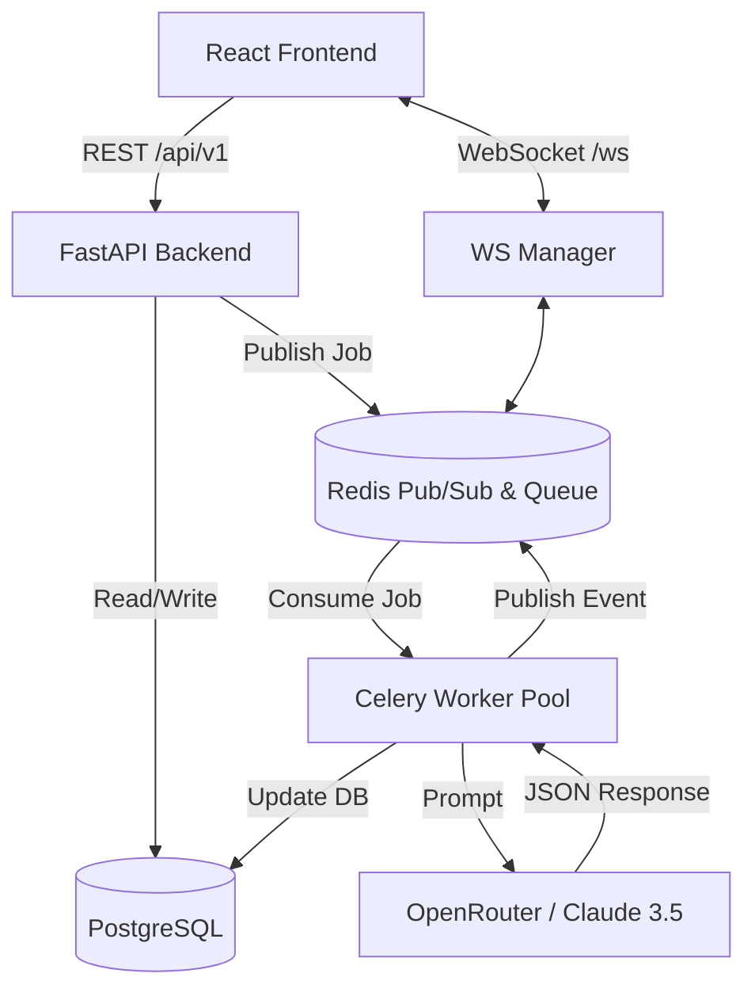
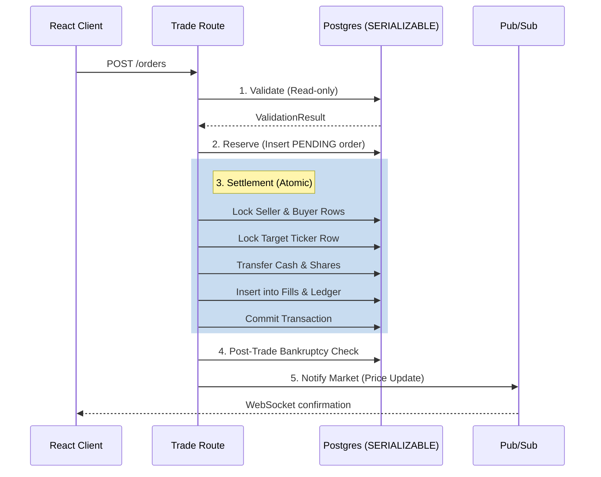

# 8. Technical Architecture

## 8.1. System Overview

**Architecture Pattern**: Event-driven microservices (lightweight) with synchronous REST for actions and asynchronous WebSocket for market data.

**Component Diagram**:

## 8.2. Backend Stack

### 8.2.1. FastAPI (REST Endpoints)

**Framework**: FastAPI 0.110+ with Python 3.11.

**Key Dependencies**:

- `asyncpg`: Async PostgreSQL driver.
- `redis-py`: For queue and caching.
- `pydantic`: Input validation and serialization.
- `websockets`: Native ASGI WebSocket support.

**Concurrency Model**:

- ASGI server: Uvicorn with `--workers 4` (CPU-bound) + `--loop uvloop`.
- Database: Async SQLAlchemy with connection pooling (20 connections).
- LLM calls: Offloaded to Celery workers (I/O bound, non-blocking).

### 8.2.2. WebSocket Manager (Real-Time Feeds)

**Implementation**: Native FastAPI WebSocket + Redis Pub/Sub for horizontal scaling (if multiple API instances).

**Connection Types**:

1. **Public Market Feed**: Single broadcast channel (`channel:market`) pushing to all connected clients.
2. **Private Team Channels**: Individual channels (`channel:team:{team_id}`) for personal updates.

**Heartbeat**: Ping/pong every 30 seconds; disconnect after 2 missed pongs.

### 8.2.3. Background Task Queue (LLM Processing)

**Queue**: Redis-backed Celery with `celery[redis]` broker.

**Worker Configuration**:

- **Pool**: `prefork` (4 processes per worker node).
- **Concurrency**: 10 tasks per worker (matches OpenRouter rate limits).
- **Retry Policy**: Exponential backoff (2^attempt seconds), max 3 retries.
- **Dead Letter Queue**: Failed tasks after retries go to `failed_directives` queue for manual review.

## 8.3. Trade Execution (Atomic Transactions)

**Critical Section: Order Execution Flow**

All stock trades follow a **five-phase atomic protocol** to prevent double-spending, ownership limit violations, and race conditions.

**ACID Guarantees**:

- **Atomicity**: Single `SERIALIZABLE` transaction per order; all-or-nothing updates.
- **Consistency**: Foreign key constraints, check constraints, trigger-based balance verification.
- **Isolation**: `SERIALIZABLE` level prevents phantom reads and write skew.
- **Durability**: Synchronous commit to PostgreSQL WAL.

## 8.4. Frontend Architecture

### 8.4.1. Terminal Aesthetic

**Design Language**:

- **Color Palette**: Dark theme (#0a0a0a background), Amber (#ffb000) for gains, Red (#ff3333) for losses, Green (#00c853) for positive vibes.
- **Typography**: Monospace primary (JetBrains Mono or IBM Plex Mono), Sans-serif secondary (Inter) for readability.
- **Layout**: Grid-based, no scrolling containers (except The Wire), fixed panes like a trading terminal.

### 8.4.2. React State Management (Extended Detail)

- **State Library**: Zustand or plain React Context for global app state.
- **WebSocket Throttling**: Use a buffer/throttle hook to prevent React re-renders from killing performance during high-frequency market updates.
- **Component Separation**: Virtualized list (e.g., `react-window`) for the Market Wire to prevent DOM bloat when 500+ news items exist.
- **Markdown Editor**: Integrated `monaco-editor` or `CodeMirror` configured for plain text/Markdown to emulate a terminal input prompt.

## 8.5. Concurrency & Scaling

### 8.5.1. 50+ Simultaneous Connections

- Single FastAPI instance can handle 50 concurrent WS connections easily.
- If scaling to 500+ teams in future: Use Redis Pub/Sub manager (asgiref + channels-redis) to broadcast across multiple API instances.

### 8.5.2. Parallel LLM Processing

**Bottleneck**: OpenRouter API allows ~2,000 req/min. With 50 teams submitting simultaneously, we queue them via Celery.
**Throttling**: Workers rate-limited to 10 concurrent API calls. If queue > 20, frontend shows "The Board is experiencing heavy volume" warning.

### 8.5.3. Race Condition Handling (Stock Trading)

**Issue**: Two teams try to buy the last 100 shares of $BRBE simultaneously.
**Solution**: Database `SERIALIZABLE` isolation level forces one transaction to wait or retry. Application layer catches `SerializationFailure` and retries up to 3 times with exponential backoff before returning "Market moved, please retry."

## 8.6. DevOps & Infrastructure

**Deployment Target**: Single robust VPS (e.g., AWS t3.xlarge or Hetzner CPX31 - 4 vCPU, 8GB RAM).
**Containerization**: `docker-compose` managing:

1. `api` (FastAPI)
2. `worker` (Celery)
3. `redis`
4. `db` (Postgres 15)
5. `frontend` (Nginx serving static React build)

**CI/CD**:

- GitHub Actions triggers on `main` merge.
- Linting (Ruff/MyPy) & Test suite runs.
- Builds Docker images and pushes to registry.
- SSH deployment script pulls latest images and runs `docker-compose up -d`.

## 8.7. Testing Strategy

1. **Unit Testing**: Pytest for pricing algorithms, score calculations, and bankruptcy state transitions.
2. **Integration Testing**: Spin up an ephemeral Postgres container to test atomic concurrent stock trades (using `asyncio.gather` to simulate race conditions).
3. **LLM Mocking**: In CI, mock the OpenRouter HTTP client to return static JSON matching the schema, avoiding costly and flaky external calls during standard test runs.
4. **WebSocket Load Testing**: Use `locust` or a custom python script with `websockets` to simulate 50 clients maintaining connections and receiving broadcast bursts.
