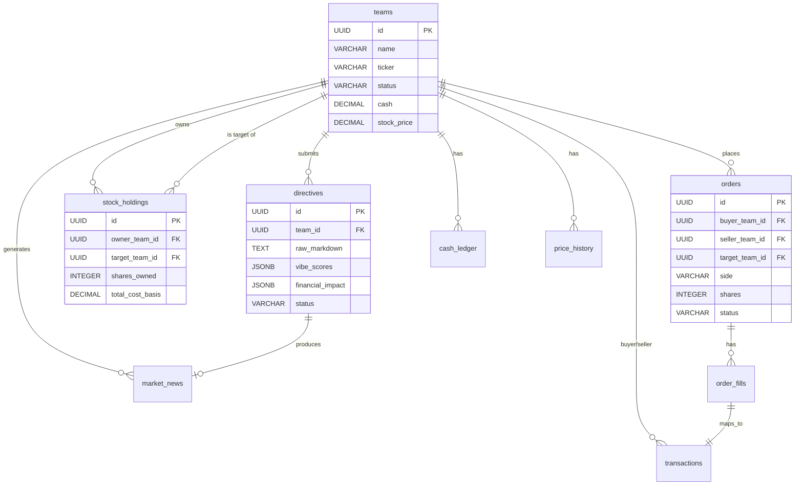

# 10. Data Models & Database Schema

## 10.1 Entity Relationship Diagram



## 10.2 PostgreSQL Schema Definitions

**Table: `teams`**
```sql
CREATE TABLE teams (
    id UUID PRIMARY KEY DEFAULT gen_random_uuid(),
    name VARCHAR(50) NOT NULL UNIQUE,
    ticker VARCHAR(5) NOT NULL UNIQUE, -- Includes $ prefix
    api_key UUID UNIQUE DEFAULT gen_random_uuid(),
    status VARCHAR(20) DEFAULT 'PENDING', -- PENDING, ACTIVE, COOLDOWN, BANKRUPT, ELIMINATED
    portfolio_id VARCHAR(50),
    swot_profile JSONB,

    -- Financial State (Mutable - source of truth for current state)
    cash DECIMAL(15,2) DEFAULT 1000000.00,
    stock_price DECIMAL(10,2) DEFAULT 100.00,
    shares_outstanding INTEGER DEFAULT 1000000,
    public_float INTEGER DEFAULT 100000,
    max_treasury_sale_pct DECIMAL(5,2) DEFAULT 10.00, -- 10%, 20%, or 30%
    treasury_sold_this_stage DECIMAL(5,2) DEFAULT 0.00, -- Running tally of treasury sales

    -- Bankruptcy tracking
    bankrupt_since TIMESTAMP WITH TIME ZONE, -- When cash first went negative
    bankrupt_resolved BOOLEAN DEFAULT FALSE, -- Whether auto-liquidation succeeded

    -- Cooldown
    cooldown_until TIMESTAMP WITH TIME ZONE,

    -- Elimination tracking
    eliminated_at TIMESTAMP WITH TIME ZONE,
    elimination_reason VARCHAR(20), -- PURGE_BOTTOM_HALF, BANKRUPTCY, DISQUALIFIED
    rank_at_elimination INTEGER,

    -- Timestamps
    created_at TIMESTAMP WITH TIME ZONE DEFAULT NOW(),
    updated_at TIMESTAMP WITH TIME ZONE DEFAULT NOW(),

    -- Constraints
    CONSTRAINT valid_status CHECK (status IN ('PENDING', 'ACTIVE', 'COOLDOWN', 'BANKRUPT', 'ELIMINATED')),
    CONSTRAINT valid_elimination_reason CHECK (elimination_reason IS NULL OR elimination_reason IN ('PURGE_BOTTOM_HALF', 'BANKRUPTCY', 'DISQUALIFIED')),
    CONSTRAINT treasury_sale_limit CHECK (treasury_sold_this_stage <= max_treasury_sale_pct)
);

CREATE INDEX idx_teams_status ON teams(status);
CREATE INDEX idx_teams_api_key ON teams(api_key);
CREATE INDEX idx_teams_bankrupt ON teams(status, bankrupt_since) WHERE status = 'BANKRUPT';
```

**Table: `directives`**
```sql
CREATE TABLE directives (
    id UUID PRIMARY KEY DEFAULT gen_random_uuid(),
    team_id UUID REFERENCES teams(id) ON DELETE CASCADE,
    raw_markdown TEXT NOT NULL,
    character_count INTEGER,

    -- LLM Output
    extraction_confidence DECIMAL(3,2),
    vibe_scores JSONB, -- {consistency: 0.85, macro_sensitivity: 0.4, aggression: 0.9, innovation: 0.6}
    financial_impact JSONB, -- {cash_delta: -50000, revenue_delta: 450000, ...}
    board_feedback TEXT,
    public_headline VARCHAR(120),

    -- Processing Metadata
    status VARCHAR(20) DEFAULT 'PROCESSING', -- PROCESSING, COMPLETED, FAILED
    error_message TEXT,
    processing_time_ms INTEGER,

    created_at TIMESTAMP WITH TIME ZONE DEFAULT NOW(),
    completed_at TIMESTAMP WITH TIME ZONE
);

CREATE INDEX idx_directives_team_id ON directives(team_id);
CREATE INDEX idx_directives_created_at ON directives(created_at DESC);
```

**Table: `orders`**
```sql
CREATE TABLE orders (
    id UUID PRIMARY KEY DEFAULT gen_random_uuid(),

    -- Participants
    buyer_team_id UUID REFERENCES teams(id), -- NULL for treasury sales
    seller_team_id UUID REFERENCES teams(id), -- NULL for market buys from float
    target_team_id UUID NOT NULL REFERENCES teams(id), -- The stock being traded

    -- Order Details
    side VARCHAR(4) NOT NULL CHECK (side IN ('BUY', 'SELL')),
    shares INTEGER NOT NULL CHECK (shares > 0),
    shares_filled INTEGER DEFAULT 0 CHECK (shares_filled >= 0 AND shares_filled <= shares),
    price_per_share DECIMAL(10,2), -- NULL for market orders (executes at current market price)

    -- Order Type & Status
    order_type VARCHAR(10) DEFAULT 'MARKET' CHECK (order_type IN ('MARKET', 'LIMIT')),
    status VARCHAR(10) DEFAULT 'PENDING' CHECK (status IN ('PENDING', 'PARTIAL', 'FILLED', 'CANCELLED', 'FAILED')),

    -- Failure tracking
    failure_reason VARCHAR(50), -- INSUFFICIENT_FUNDS, INSUFFICIENT_SHARES, OWNERSHIP_LIMIT, FLOAT_EXHAUSTED, etc.

    -- Timestamps
    created_at TIMESTAMP WITH TIME ZONE DEFAULT NOW(),
    executed_at TIMESTAMP WITH TIME ZONE, -- When fully filled or failed
    expires_at TIMESTAMP WITH TIME ZONE, -- For future limit order support

    -- Constraints
    CONSTRAINT buyer_or_seller CHECK (
        (side = 'BUY' AND buyer_team_id IS NOT NULL) OR
        (side = 'SELL' AND seller_team_id IS NOT NULL) OR
        (side = 'SELL' AND seller_team_id IS NULL) -- Treasury sale
    )
);

CREATE INDEX idx_orders_buyer ON orders(buyer_team_id, status, created_at DESC);
CREATE INDEX idx_orders_seller ON orders(seller_team_id, status, created_at DESC);
CREATE INDEX idx_orders_target ON orders(target_team_id, status, created_at DESC);
CREATE INDEX idx_orders_pending ON orders(status, created_at) WHERE status IN ('PENDING', 'PARTIAL');
```

**Table: `order_fills`**
```sql
CREATE TABLE order_fills (
    id UUID PRIMARY KEY DEFAULT gen_random_uuid(),
    order_id UUID NOT NULL REFERENCES orders(id) ON DELETE CASCADE,

    -- Fill Details
    shares INTEGER NOT NULL CHECK (shares > 0),
    price_per_share DECIMAL(10,2) NOT NULL,
    total_value DECIMAL(15,2) NOT NULL,

    -- Counterparty (for market orders, this may be multiple fills)
    counterparty_order_id UUID REFERENCES orders(id), -- NULL if filled from public float/treasury

    -- Timestamp
    filled_at TIMESTAMP WITH TIME ZONE DEFAULT NOW()
);

CREATE INDEX idx_fills_order ON order_fills(order_id);
CREATE INDEX idx_fills_counterparty ON order_fills(counterparty_order_id);
```

**Table: `stock_holdings`**
```sql
CREATE TABLE stock_holdings (
    id UUID PRIMARY KEY DEFAULT gen_random_uuid(),
    owner_team_id UUID REFERENCES teams(id) ON DELETE CASCADE,
    target_team_id UUID REFERENCES teams(id) ON DELETE CASCADE,
    shares_owned INTEGER NOT NULL DEFAULT 0 CHECK (shares_owned >= 0),

    -- Cost basis tracking for PnL calculation
    total_cost_basis DECIMAL(15,2) DEFAULT 0.00, -- Sum of all purchase costs
    average_cost_basis DECIMAL(10,2) GENERATED ALWAYS AS (
        CASE
            WHEN shares_owned > 0 THEN total_cost_basis / shares_owned
            ELSE 0
        END
    ) STORED,

    updated_at TIMESTAMP WITH TIME ZONE DEFAULT NOW(),

    UNIQUE(owner_team_id, target_team_id)
);

CREATE INDEX idx_holdings_owner ON stock_holdings(owner_team_id);
CREATE INDEX idx_holdings_target ON stock_holdings(target_team_id);
```

**Table: `cash_ledger`**
```sql
CREATE TABLE cash_ledger (
    id UUID PRIMARY KEY DEFAULT gen_random_uuid(),
    team_id UUID NOT NULL REFERENCES teams(id) ON DELETE CASCADE,

    -- Transaction Classification
    entry_type VARCHAR(20) NOT NULL CHECK (entry_type IN (
        'INITIAL_CAPITAL',      -- Starting $1M
        'TRADE_PROCEEDS',       -- From selling stock
        'TRADE_PAYMENT',        -- From buying stock
        'DIRECTIVE_COST',       -- Marketing/RD spend from LLM
        'DIRECTIVE_REVENUE',    -- Revenue from operations
        'TREASURY_SALE',        -- Selling own shares
        'DIVIDEND',             -- Future use
        'BANKRUPTCY_LIQUIDATION', -- Auto-sell holdings
        'ADMIN_ADJUSTMENT'      -- Manual correction
    )),

    -- Amounts (positive = credit, negative = debit)
    amount DECIMAL(15,2) NOT NULL,
    balance_after DECIMAL(15,2) NOT NULL,

    -- Reference to source
    reference_type VARCHAR(20), -- ORDER, DIRECTIVE, ADMIN_ACTION
    reference_id UUID,          -- orders.id or directives.id

    -- Human readable
    description TEXT,

    created_at TIMESTAMP WITH TIME ZONE DEFAULT NOW()
);

CREATE INDEX idx_ledger_team_time ON cash_ledger(team_id, created_at DESC);
CREATE INDEX idx_ledger_reference ON cash_ledger(reference_type, reference_id);
```

**Table: `transactions`**
```sql
CREATE TABLE transactions (
    id UUID PRIMARY KEY DEFAULT gen_random_uuid(),

    -- Parties
    buyer_team_id UUID REFERENCES teams(id),
    seller_team_id UUID REFERENCES teams(id), -- NULL if buying from float
    target_team_id UUID REFERENCES teams(id), -- The stock being traded

    -- Economics (denormalized from order_fills for quick lookup)
    shares INTEGER NOT NULL,
    price_per_share DECIMAL(10,2) NOT NULL,
    total_value DECIMAL(15,2) NOT NULL,

    -- Classification
    transaction_type VARCHAR(20) CHECK (transaction_type IN (
        'MARKET_BUY',
        'MARKET_SELL',
        'TREASURY_SALE',
        'BANKRUPTCY_LIQUIDATION'
    )),

    -- Source
    order_fill_id UUID REFERENCES order_fills(id),

    executed_at TIMESTAMP WITH TIME ZONE DEFAULT NOW()
);

CREATE INDEX idx_transactions_target_time ON transactions(target_team_id, executed_at DESC);
CREATE INDEX idx_transactions_buyer ON transactions(buyer_team_id, executed_at DESC);
CREATE INDEX idx_transactions_seller ON transactions(seller_team_id, executed_at DESC);
```

**Table: `price_history`**
```sql
CREATE TABLE price_history (
    id UUID PRIMARY KEY DEFAULT gen_random_uuid(),
    team_id UUID NOT NULL REFERENCES teams(id) ON DELETE CASCADE,

    -- Price Data
    price DECIMAL(10,2) NOT NULL,
    market_cap DECIMAL(20,2) NOT NULL,

    -- Volume Data
    volume_24h INTEGER DEFAULT 0, -- Shares traded in last 24h (or since last calc)
    net_flow DECIMAL(5,4), -- (BuyVolume - SellVolume) / PublicFloat, range [-1, 1]

    -- Vibe Multiplier (the "black box" factor)
    vibe_multiplier DECIMAL(5,4), -- 0.5 to 1.0 typically
    consistency_score DECIMAL(3,2),
    macro_sensitivity_score DECIMAL(3,2),

    -- Fundamental components (for transparency to admins)
    profit_component DECIMAL(10,2), -- (Pi * 10)
    cash_component DECIMAL(10,2),   -- (C * 0.1)

    calculated_at TIMESTAMP WITH TIME ZONE DEFAULT NOW()
);

-- Time-series optimization
CREATE INDEX idx_price_history_team_time ON price_history(team_id, calculated_at DESC);
CREATE INDEX idx_price_history_time ON price_history(calculated_at DESC);
```

**Table: `market_news`**
```sql
CREATE TABLE market_news (
    id UUID PRIMARY KEY DEFAULT gen_random_uuid(),
    headline VARCHAR(120) NOT NULL,
    content TEXT, -- Detailed body (optional)

    source_type VARCHAR(20) CHECK (source_type IN ('GLOBAL', 'TEAM_ACTION', 'SYSTEM', 'ADMIN_INJECTED')),
    source_team_id UUID REFERENCES teams(id), -- If TEAM_ACTION

    -- Impact tracking
    sentiment_score DECIMAL(3,2), -- -1.0 to +1.0
    affected_sectors VARCHAR(50)[], -- ['TECH', 'FIN', 'REIT', 'ENG', 'CONS']
    affected_tickers VARCHAR(5)[], -- ['$BRBE', '$APEX']

    -- Saturation detection
    strategy_fingerprint VARCHAR(50), -- Hash of action type for clustering
    similar_news_count INTEGER DEFAULT 0, -- How many similar items in last 15 min

    -- Metadata for LLM context
    relevance_decay DECIMAL(3,2) DEFAULT 1.00, -- 1.0 (fresh) to 0.0 (stale)

    created_at TIMESTAMP WITH TIME ZONE DEFAULT NOW()
);

CREATE INDEX idx_news_created ON market_news(created_at DESC);
CREATE INDEX idx_news_source ON market_news(source_type, created_at DESC);
CREATE INDEX idx_news_team ON market_news(source_team_id, created_at DESC) WHERE source_team_id IS NOT NULL;
CREATE INDEX idx_news_fingerprint ON market_news(strategy_fingerprint, created_at DESC)
    WHERE strategy_fingerprint IS NOT NULL;
```

**Table: `game_state`**
```sql
CREATE TABLE game_state (
    id INTEGER PRIMARY KEY DEFAULT 1 CHECK (id = 1), -- Singleton constraint

    -- Event Lifecycle
    status VARCHAR(20) CHECK (status IN ('SETUP', 'ACTIVE', 'PAUSED', 'FINISHED')),
    started_at TIMESTAMP WITH TIME ZONE,
    paused_at TIMESTAMP WITH TIME ZONE,
    resumed_at TIMESTAMP WITH TIME ZONE,
    finished_at TIMESTAMP WITH TIME ZONE,

    -- Purge Tracking
    current_round INTEGER DEFAULT 0, -- 0 = before first purge
    last_purge_at TIMESTAMP WITH TIME ZONE,
    next_purge_scheduled TIMESTAMP WITH TIME ZONE,
    teams_remaining INTEGER,

    -- Operational
    llm_queue_depth INTEGER DEFAULT 0,
    total_llm_cost_usd DECIMAL(10,2) DEFAULT 0.00,

    updated_at TIMESTAMP WITH TIME ZONE DEFAULT NOW()
);

-- Prevent multiple rows
CREATE UNIQUE INDEX idx_game_state_singleton ON game_state((true)) WHERE id = 1;
```
