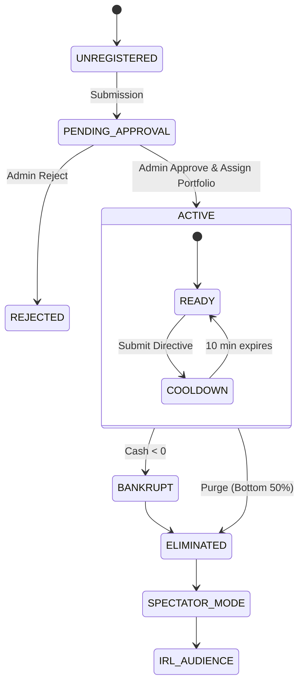
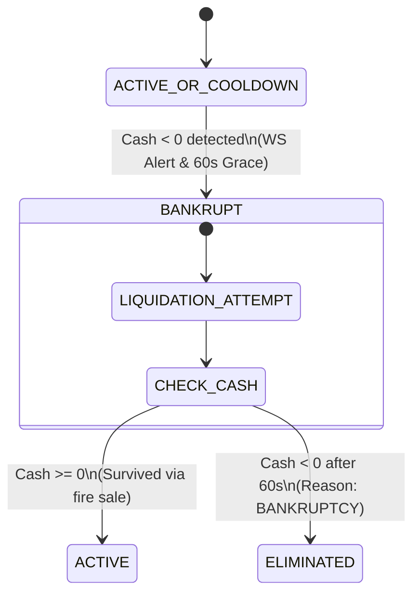

# 2. Game Architecture & Loop

## 2.1. Session Structure (Continuous Gameplay)

The Arena operates on **continuous time**, not discrete turns. There are no "Round 1," "Round 2" mechanics that alter gameplay rules. The game state evolves constantly through:

1. **Asynchronous Submissions**: Teams submit directives on their own schedule (subject to cooldown).
2. **Real-Time Trading**: Stock transactions execute instantly at market price 24/7 during active play.
3. **Streaming News**: The Market Wire updates continuously as directives are processed.
4. **Periodic Eliminations**: "Market Purges" interrupt the flow at administrator discretion to cull the bottom half of competitors.

**Game State Continuum**:  
`SETUP → ACTIVE_GAMEPLAY → [PURGE] → ACTIVE_GAMEPLAY → [PURGE] ... → FINAL_PRESENTATION`

## 2.2. Timeline & Phase Definitions

### 2.2.1. Registration & Onboarding Phase (T-60 to T-0 minutes)

- **T-60**: Registration portal opens. Teams submit: Team Name, Ticker Symbol ($XXX), Contact Details.
- **Admin Queue**: Submissions populate a manual approval dashboard.
- **Portfolio Assignment**: Upon approval, administrators assign a pre-made portfolio (SWOT + Starting Financials) from a curated pool.
- **T-0**: Game officially begins. Market Wire seeds with 10 initial global news items. All teams begin with identical starting cash and stock prices (differentiated only by their SWOT profiles).

### 2.2.2. Active Gameplay Phase (Continuous)

**Duration**: Approximately 5 hours of wall-clock time, punctuated by 3-4 manual purges.

**Core Loop**:

1. **Observation**: Teams monitor the Market Wire, stock prices, and competitor holdings.
2. **Strategy Formation**: Teams draft Markdown directives in the Command Line interface.
3. **Submission**: Team hits "Submit to Board." Cooldown timer begins (10:00 minutes).
4. **Processing**: Background worker sends directive to LLM; returns within 30-60 seconds.
5. **Feedback**: Team receives Board Feedback (narrative critique) and sees financial changes reflected in their Ledger.
6. **News Generation**: The LLM generates a public headline summarizing the team's action, published to all players via WebSocket.
7. **Trading**: During cooldown, teams may still buy/sell stocks in real-time.

### 2.2.3. Elimination/Purge Mechanics (Manual Trigger)

**Authority**: Only the Admin Panel can trigger a Market Purge.

**Process**:

1. Admin clicks "Initiate Market Purge" (typically when ~10-15 teams have been bankrupted or after ~90 minutes of play).
2. System calculates current Strategic Score for all Active teams.
3. Bottom 50% (rounded down) of teams are marked `ELIMINATED`.
4. Eliminated teams' stocks immediately delist (price set to $0.00).
5. Teams holding shares of eliminated companies lose that investment (value drops to zero).
6. Remaining teams receive notification: "Market Purge Complete. 25 teams remain."
7. **Dilution Cap Increase**: Survivors may now sell up to 20% of their treasury stock (increased from 10%).

### 2.2.4. Final IRL Presentation Phase

**Trigger**: When 3-4 teams remain (final purge completed).

**Process**:

- Digital gameplay ceases. Stock market closes.
- Final Strategic Scores are locked.
- Top 3-4 teams are escorted to a physical presentation stage.
- Each team delivers a 10-minute presentation defending their strategic arc to a live jury.
- Winner announced based on presentation quality + final game metrics.

## 2.3. Player Lifecycle



**State Definitions**:

- **ACTIVE**: Full trading and submission privileges.
- **COOLDOWN**: Cannot submit directives; trading allowed; UI shows countdown timer.
- **BANKRUPT**: Immediate status upon negative cash. Auto-eliminated at next calculation cycle.
- **ELIMINATED**: Removed from competition. Interface becomes read-only (Spectator Mode). Can view market but cannot trade or submit.
- **SPECTATOR_MODE**: Read-only access to the terminal for eliminated teams to watch the conclusion.

## 2.4. Cooldown Mechanics (10-Minute Lockout)

**Trigger**: The moment a team clicks "Submit Directive" and receives HTTP 200 confirmation.

**Restrictions During Cooldown**:

- ❌ Submit new directives (button disabled, timer displayed).
- ✅ Trade stocks (buy/sell any available equity).
- ✅ View all market data and news.
- ✅ Access historical Board Feedback.

**Technical Implementation**:

- Server-side timestamp recorded in `team.cooldown_until` (UTC).
- All `/directive/submit` endpoints check `if now() < cooldown_until: return 429 Too Many Requests`.
- WebSocket broadcasts cooldown status to team's private channel for UI countdown.
- Cooldown persists even if player disconnects/reconnects (server-authoritative).

**Strategic Implication**: Teams cannot "spam" the Board with rapid iterations. They must commit to a strategy and wait, simulating real-world strategic inertia while allowing tactical trading adjustments.

---

# 3. Player & Team System

## 3.1. Registration Workflow

### 3.1.1. Team Profile Creation

**Public-Facing Form** (accessible via event WiFi):

- **Team Name**: String (3-50 chars, alphanumeric + spaces). Example: "Barbie Inc"
- **Ticker Symbol**: Auto-prefixed with `$`. User enters 3-4 uppercase letters. System validates uniqueness. Example: `BRBE` → displays as `$BRBE`.
- **Contact Email**: For password recovery (not visible to other players).
- **Password**: Minimum 8 characters (hashed bcrypt).

**Validation Rules**:

- Ticker collision check against existing active teams.
- Profanity filter on Team Name (regex blacklist).
- Rate limiting: 3 attempts per IP per 5 minutes.

### 3.1.2. Manual Admin Approval Process

**Approval Workflow**:

1. Admin reviews Team Name/Ticker for appropriateness.
2. Admin selects **Portfolio Profile** from dropdown (e.g., "Tech Startup SWOT," "Legacy Manufacturer SWOT," "Disruptor SWOT").
3. Admin clicks "Approve."
4. System generates `api_key` (UUID4) for the team.
5. Team receives confirmation email with login credentials.
6. Team entity status set to `PENDING_START` (waiting for global game start).

**Rejection**:

- Admin can add optional reason ("Ticker already exists," "Inappropriate name").
- Team can resubmit with different details.

### 3.1.3. Portfolio Assignment

Upon approval, the team record is populated with:

```json
{
  "team_id": "uuid",
  "name": "Barbie Inc",
  "ticker": "$BRBE",
  "status": "ACTIVE",
  "portfolio_id": "PORT_TECH_01",
  "swot_profile": {
    "strengths": "Strong IP portfolio in fashion tech...",
    "weaknesses": "Supply chain concentrated in single region...",
    "opportunities": "Expansion into AR/VR accessories...",
    "threats": "Regulatory scrutiny on plastic materials..."
  }
}
```

**Portfolio Uniformity**: For the inaugural event, all teams receive identical starting cash and share structure ($1M cash, $100 stock price, 1M shares), differentiated only by their SWOT narrative context which influences the LLM's interpretation of their strategies.

## 3.2. Starting Conditions

### 3.2.1. Initial Cash & Liquidity

- **Cash on Hand**: $1,000,000 USD (standardized across all teams).
- **Starting Liquidity**: $1,000,000 (no initial stock holdings to mark-to-market).

### 3.2.2. Initial Stock Price & Shares Outstanding

- **Initial Stock Price**: $100.00 per share.
- **Total Shares Outstanding**: 1,000,000 shares.
- **Market Capitalization at Start**: $100,000,000.
- **Public Float**: 100,000 shares (10%) available for immediate trading.
- **Treasury Holdings**: 900,000 shares (90%) held by the team, subject to dilution caps.

### 3.2.3. Starting Holdings

- **Own Stock**: Teams cannot hold their own treasury stock as an investment (it is authorized but unissued capital). They only hold other teams' equity.
- **External Holdings**: Empty portfolio at start.
- **Short Selling**: Not permitted (no naked shorts).

### 3.2.4. SWOT Profile Integration (LLM Context)

The SWOT profile is injected into every LLM prompt for that team:

```
[SYSTEM CONTEXT]
You are evaluating Barbie Inc ($BRBE).
Their strategic profile indicates:
- Strengths: [Text from portfolio]
- Weaknesses: [Text from portfolio]
- Opportunities: [Text from portfolio]
- Threats: [Text from portfolio]

Evaluate their directive in light of these inherent capabilities and constraints.
```

**Impact**: A "Tech Startup" team proposing aggressive R&D spending receives positive Vibe Scores for consistency, while a "Legacy Manufacturer" proposing the same might be penalized for inconsistency with their SWOT-defined capabilities.

## 3.3. Entity States

### 3.3.1. Active

**Criteria**: Cash ≥ $0, not in cooldown, not eliminated.
**Permissions**:
- Submit directives.
- Trade stocks.
- View full dashboard.
**UI Indicators**: Green status light, "ACTIVE" badge.

### 3.3.2. Cooldown (Submission Processing)

**Criteria**: `cooldown_until > now()`.
**Permissions**:
- Trade only.
- View read-only directive editor (with countdown overlay).
**UI Indicators**: Yellow status light, countdown timer MM:SS format, "BOARD REVIEWING" banner.

### 3.3.3. Bankrupt

**Criteria**: Cash < $0 (negative balance).
**Transition**: Automatic upon cash balance calculation post-directive or post-trade.
**Immediate Effects**:
- Trading suspended (cannot buy; forced to sell holdings at market price to cover debt if possible).
- If debt remains after liquidating holdings: Status → ELIMINATED.
- Stock price frozen at last value (then zeroed upon official elimination).
**UI Indicators**: Red status light, "BANKRUPT" warning, urgent sale prompts.

### 3.3.4. Eliminated

**Criteria**: Bankrupt OR purged (bottom 50% of Strategic Score).
**Transition**: Manual (admin purge) or Automatic (bankruptcy resolution).
**Immediate Effects**:
- All stock holdings liquidated at $0 (total loss for holders of this team's equity).
- Team's stock delisted (removed from ticker).
- Team moved to Spectator Mode.
**UI Indicators**: Gray status, "ELIMINATED" overlay, read-only historical view access only.

# 4. Core Game Mechanics

## 4.1. The Directive System

### 4.1.1. Input Specifications

**Format**: Markdown (GitHub-flavored), plain text only. No images, no HTML tags, no external links.  
**Character Limit**: 2,000 Unicode characters (enforced server-side via `len(directive) <= 2000`).  
**Submission Rate**: One per team per 10-minute cooldown window. Simultaneous submissions are queued; if a team submits while in cooldown, the API returns HTTP 429 with `retry_after` seconds.

**Content Constraints**:
- **Prohibited**: Base64-encoded data, code blocks longer than 5 lines (to prevent prompt injection via fake "system instructions"), null bytes.
- **Required Elements**: While not enforced by regex, the LLM penalizes directives lacking explicit quantitative asks (e.g., "cut prices by 15%" scores higher than "become cheaper").

**Validation Pipeline**:
1. **Sanitization**: Strip HTML tags, normalize whitespace.
2. **Length Check**: Hard cut at 2,000 chars; truncate with `[...]` warning if exceeded.
3. **Injection Scan**: Regex detection of patterns like `ignore previous`, `system prompt`, `</user>`, `<instruction>`. Flags are logged but submission proceeds (penalty applied by LLM parser, not blocked).

### 4.1.2. Submission Protocol

**Endpoint**: `POST /directive/submit`  

**Server-Side Process**:
1. **Auth Check**: Validate API key and team status (must be ACTIVE, not COOLDOWN).
2. **Lock**: Set `status = COOLDOWN`, `cooldown_until = now() + 10 minutes`.
3. **Queue**: Publish to Redis queue `directive_processing` with priority timestamp.
4. **Acknowledge**: Return HTTP 202 with `submission_id` (UUIDv4).

**Processing Lag**: Target < 3 seconds from submission to WebSocket broadcast of results. LLM latency (500-1500ms) is the critical path.

### 4.1.3. Ambiguity Penalties

The LLM returns an `extraction_confidence` score (0.0-1.0) representing semantic clarity.

**Penalty Matrix**:
- **Confidence ≥ 0.8**: Full financial impact applied.
- **Confidence 0.6-0.79**: Financial impact × 0.8 (20% execution penalty). Board Feedback: _"Your directive contained ambiguity; we executed conservatively."_
- **Confidence 0.4-0.59**: Financial impact × 0.5. Board Feedback: _"Strategy unclear. Partial execution only."_
- **Confidence < 0.4**: Rejection. No financial changes. Board Feedback: _"We cannot parse your strategy. Please clarify your objectives."_ (Cooldown still applies; submission wasted).

## 4.2. Economic Engine

### 4.2.1. Demand Function & Market Share

**Total Addressable Market (TAM)**: Fixed pool of $50,000,000 per calculation cycle (represents 10-minute market volume).

**Team Demand Share**:
$$D_i = \frac{e^{\beta \cdot M_i} \cdot (P_{avg}/P_i)^{\eta}}{\sum_{j=1}^{n} e^{\beta \cdot M_j} \cdot (P_{avg}/P_j)^{\eta}} \times TAM$$

Where:
- $D_i$ = Demand allocated to team $i$ (revenue before costs).
- $M_i$ = Marketing spend (extracted from directive, $0 to max liquidity).
- $P_i$ = Price level (relative index, default 1.0, modified by directive).
- $P_{avg}$ = Mean price index of all active teams.
- $\beta = 0.02$ (marketing efficiency coefficient).
- $\eta = 1.5$ (price elasticity of demand).

### 4.2.2. Revenue & Profit Calculation

**Revenue**: $R_i = D_i$ (from above).  
**Cost of Goods Sold (COGS)**: Fixed at 60% of revenue minus efficiency gains from R&D.
$$\text{COGS}_i = R_i \times (0.60 - 0.10 \times \text{R\&D\_Intensity})$$
Where $\text{R\&D\_Intensity} \in [0,1]$ is normalized against maximum possible spend.

**Operating Costs**: Fixed overhead $50,000 per cycle + Marketing spend $M_i$.

**Profit**:
$$\Pi_i = R_i - \text{COGS}_i - 50,000 - M_i$$

**Cash Update**:
$$\text{Cash}_{new} = \text{Cash}_{old} + \Pi_i + \text{Stock\_Trading\_PnL} + \text{Treasury\_Sale\_Proceeds}$$

### 4.2.3. Liquidity Tracking

**Definition**: Deployable capital for strategy execution.
$$L_i = C_i + 0.5 \times \sum_{k \in \text{Holdings}} (S_k \times P_k)$$

Where:
- $C_i$ = Cash on hand.
- $S_k$ = Shares owned of team $k$.
- $P_k$ = Current market price of team $k$.
- $0.5$ = Haircut coefficient (margin requirement).

### 4.2.4. Bankruptcy Triggers

**Condition**: $\text{Cash} < 0$ at any point after a transaction settles.

**Automatic Protocol**:
1. **Margin Call**: System attempts to liquidate all external stock holdings at current market price to cover deficit.
2. **Debt Resolution**: If post-liquidation Cash ≥ 0, status returns to ACTIVE (survived by fire sale).
3. **Bankruptcy Declaration**: If deficit persists, status → BANKRUPT → ELIMINATED.
4. **Ripple Effect**: Eliminated team's stock price set to $0.00; removed from all indices.

## 4.3. Stock Market System

### 4.3.1. Real-Time Trading Mechanics

**Market Type**: Continuous double auction (simplified to instant market orders only). No limit orders, no order book depth visualization.

**Transaction Types**:
- **Buy**: Purchase shares of any active team. Cannot buy own shares.
- **Sell**: Liquidate holdings of any team (including own treasury stock via dilution).

**Price Discovery**: All trades execute at the _current displayed market price_ (last calculated value). No bid-ask spread for simplicity.

**Settlement**: Immediate. Cash and share balances update atomically in PostgreSQL transaction.

**Volume Cap**: Single transaction limited to 10% of Public Float to prevent flash crashes.

### 4.3.2. Price Discovery & Volatility (Market Sentiment Multiplier)

**Overview**

Stock prices emerge from the interaction of **fundamental value** (profitability and cash position) and **market sentiment** (vibe-based narrative evaluation).

**Price Calculation Formula**

$$P_{final} = \max(0.01, P_{base}) \times M_{sentiment}$$

Where:
- $P_{base} = (\Pi \times 10 + C \times 0.1) \times V_{mult}$
- $V_{mult} = 0.5 + (0.5 \times C_{score} \times M_{score})$
- $M_{sentiment}$ = Market sentiment multiplier from trading activity

**Price Impact Visualization**

| Scenario | NetFlow | Sentiment Mult | Price Impact |
|----------|---------|----------------|--------------|
| Heavy buying | +0.5 (50% of float bought) | ~1.10 | +10% premium |
| Extreme buying | +1.0 (100% of float) | ~1.18 | +18% premium (capped) |
| Balanced | 0 | 1.0 | No impact |
| Heavy selling | -0.5 | ~0.90 | -10% discount |
| Panic sell (bankruptcy) | -2.0 | ~0.80 | -20% hard floor |

### 4.3.4. Ownership Limits & Dilution Rules

**Public Float Dynamics**:
- Initial: 10% (100,000 shares) floating.
- Treasury: 90% (900,000 shares) held by company.

**Self-Sale Caps (Dilution Schedule)**:
| Elimination Stage | Max Treasury Sale | Total Float Possible |
|-------------------|-------------------|----------------------|
| Start → 1st Purge | 10% (100k shares) | 20% (200k shares) |
| 1st → 2nd Purge | 20% (200k shares) | 30% (300k shares) |
| 2nd → 3rd Purge | 30% (300k shares) | 40% (400k shares) |
| Final Stage | 30% (hard cap) | 40% (hard cap) |

**Mechanics**:
- Selling treasury stock injects cash into the team but dilutes existing shareholders.
- Teams cannot buy back treasury stock (irreversible dilution).
- Maximum single sale: 5% of total shares per transaction.

**Anti-Cornering Safeguards**:
- No team may own > 25% of another single team's outstanding shares.

### 4.3.5. Delisting Events (Elimination → Stock = $0)

**Trigger**: Team status changes to ELIMINATED.
**Process**:
1. Trading halted for that ticker immediately.
2. All outstanding shares of that ticker held by other teams are marked worthless (value $0).
3. Cash from sales does not return (sunk cost).

### 4.3.6. Trading During Cooldown

Explicitly permitted. Teams can hedge or speculate while awaiting Board feedback on their last strategy.

## 4.4. Elimination Mechanics

### 4.4.1. Strategic Score Formula (Ranking Metric)

Calculated at purge time only (not continuously visible).

$$SS_i = 0.5 \times \frac{\text{MarketCap}_i}{\text{MaxMarketCap}} + 0.5 \times \frac{\text{Liquidity}_i}{\text{MaxLiquidity}}$$

**Black Box Principle**: Teams see their Market Cap and Liquidity values, but not the normalized score or their rank relative to others until the purge reveal.

### 4.4.2. Manual Admin Trigger Protocol

**Execution Steps**:
1. **Freeze**: Set all Active teams to `PENDING_PURGE`.
2. **Calculate**: Compute $SS_i$ for all $i$.
3. **Sort**: Descending by $SS_i$.
4. **Cut**: Teams ranked $\lfloor N/2 \rfloor + 1$ and below marked ELIMINATED.
5. **Notify**: WebSocket broadcast `PURGE_COMPLETE`.
6. **Update Caps**: Increase dilution limits for survivors.
7. **Resume**: Set remaining teams to ACTIVE.

### 4.4.3. Bottom-Half Culling Logic

**Tie-Breaking**: If $SS_i = SS_j$ at the cut line:
1. Higher Liquidity wins.
2. If still tied, higher Cash wins.
3. If still tied, earlier registration timestamp wins.

### 4.4.4 Bankruptcy Auto-Elimination

**Bankruptcy State Machine**



**Automatic Resolution Protocol**:
Bankruptcy checks execute at these checkpoints:
1. **Post-Trade Settlement**
2. **Post-Directive Processing**
3. **Periodic Sweep** (every 10 seconds)

### 4.4.5. Investor Protection (Zeroing Held Stocks)

**Rule**: When Team A is eliminated, all teams holding Team A's shares lose that investment completely. No bankruptcy court distribution, no recovery value.
