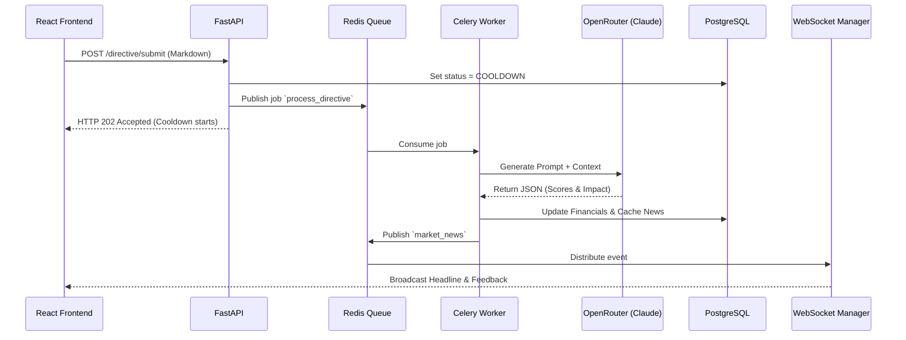
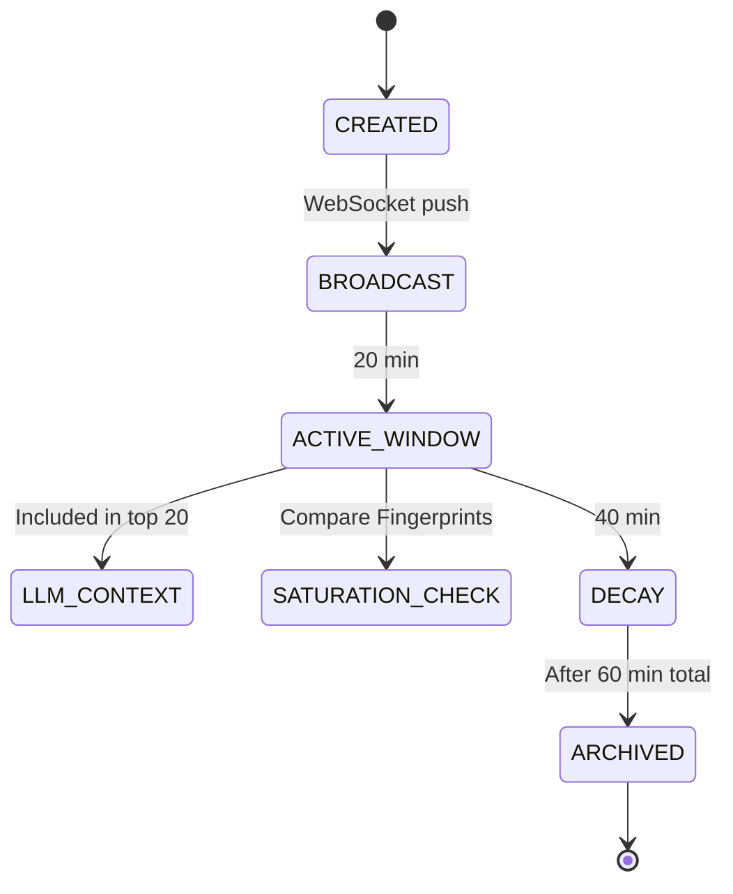

# 5. The Board (LLM Judge System)

## 5.1. Architecture Overview

**The Parser-Judge Pipeline** is an async worker architecture:

**Decoupling**: The game loop does not wait for LLM responses; teams enter cooldown immediately upon submission. LLM processing occurs in background (typically 1-3 seconds).

## 5.2. Model Specifications

**Primary Model**: `anthropic/claude-3.5-sonnet` via OpenRouter.  
**Fallback Model**: `anthropic/claude-3-haiku` (if Sonnet latency > 10s or rate limited).

**Parameters**:

- **Temperature**: 0.4 (controlled creativity; coherent but not robotic).
- **Max Tokens**: 800 (sufficient for JSON output + narrative feedback).
- **Top P**: 0.9.
- **System Prompt**: Fixed, never exposed to players.

**Cost Controls**:

- Input: ~1,500 tokens average (SWOT + News + Directive).
- Output: ~300 tokens average.
- Cost per submission: ~$0.006 (Claude Sonnet).
- 50 teams × 20 submissions = 1,000 calls = **~$6.00 total LLM cost per event**.

## 5.3. Input Context Schema

The LLM receives a structured context block (XML-delimited to prevent injection). It contains:

1. Team Metadata (`<META>`)
2. Current Financials (`<FINANCIAL_STATE>`)
3. Static SWOT Profile (`<SWOT_PROFILE>`)
4. Last 20 News Items (`<MARKET_CONTEXT>`)
5. The User's Raw Markdown (`<USER_DIRECTIVE>`)

## 5.4. Output Schema (Structured JSON)

The LLM must return valid JSON matching this schema:

- `extraction`: Parsed numeric values (pricing_magnitude, marketing_spend, confidence).
- `vibe_scores`: Qualitative assessments (consistency, macro_sensitivity, aggression, innovation).
- `financial_impact`: Calculated delta changes applied to the database.
- `board_feedback`: Narrative string returning to the user + public wire headline.

## 5.5. Prompt Injection Defenses

**Layer 1: XML Isolation** (User content inside CDATA).
**Layer 2: System Prompt Fortress** (Explicit instructions to ignore "ignore previous" commands).
**Layer 3: Output Schema Validation** (Pydantic model fallback and retries).
**Layer 4: Content Moderation** (Regex scanning).
**Layer 5: Semantic Consistency Check** (Flagging wildly inconsistent but confident directives).

## 5.6. Error Handling

- **Low Confidence (<0.4)**: Rejected, financial changes zeroed. Cooldown consumed.
- **LLM Timeout (>10s)**: Fallback to Haiku.
- **Rate Limit**: Exponential backoff retry.
- **Malformed Math**: Auto-corrected by deterministic Python logic.

---

# 6. News & Market Wire System

## 6.1. News Architecture & Lifecycle

**Overview**: The Market Wire is the **central nervous system** of the simulation—every strategic action becomes public information, creating the reflexive market dynamics.

**News Lifecycle States**:

**News Taxonomy**:

1. `GLOBAL` (Admin injection, e.g., "Fed hikes rates")
2. `TEAM_ACTION` (LLM generation from directives)
3. `SYSTEM` (Automatic game events, e.g., Purges)
4. `ADMIN_INJECTED` (Manual steering)

## 6.2. WebSocket Feed Specifications

**Connection**: `/ws/market` (public) and `/ws/team/{api_key}` (private).

**Rolling Window**: Server maintains `deque` of last 20 news items. New subscribers receive immediate burst of current 20, then live updates.

## 6.3. Context Awareness

**LLM Context Window Management**:
The LLM receives only the **20 most recent** news items. Items are formatted as `[T-5] $APEX announces AI division`.

**News Relevance Decay**:
Older news has implicitly lower weight. Explicit recency bias relies on the LLM's understanding of timestamps.

**Saturation Avoidance**:
If 5+ teams submit similar strategies within 15 minutes (e.g., all cutting prices), the system flags a "strategy_fingerprint" match. The LLM applies lower `macro_sensitivity` scores to late movers (they're following, not leading) and generates headlines like "Market-wide price war erupts".

---

# 7. Scoring & Leaderboard System

## 7.1. Strategic Score Formula (Financial + Vibe Composite)

The Strategic Score is the **sole elimination metric**, calculated only during Market Purges.

**Formula**:
$$SS_i = 0.5 \times \frac{MC_i}{\max(MC)} + 0.5 \times \frac{L_i}{\max(L)}$$
_(Where $MC_i$ = Market Cap, $L_i$ = Liquidity. Normalization uses max among active teams)._

**Black Box Rules**:
| Data | Visible to Team | Visible to Others | Visible Post-Elimination |
|------|-----------------|-------------------|--------------------------|
| Market Cap | ✅ Real-time | ✅ Real-time | ✅ Final |
| Liquidity | ✅ Real-time | ❌ Hidden | ✅ Final |
| Strategic Score | ❌ Never | ❌ Never | ✅ If eliminated |
| Rank | ❌ Never | ❌ Never | ✅ Final rank revealed |

## 7.2. Black Box Scoring Philosophy

**Principle**: Players see inputs and outputs, never the transformation function.
**Psychological Objective**: Force teams to optimize for absolute performance (profit, stock price) while managing qualitative narrative coherence, rather than gaming a specific formula.

## 7.3. Leaderboard Visibility Rules

- **During Active Gameplay**: No public leaderboard. Teams infer standing via the ticker and news flow.
- **At Purge Events**: Admin triggers reveal. Only binary status (Survived/Eliminated) and Top Performer revealed.
- **Final Phase**: Full disclosure for top remaining teams for their IRL presentation.
