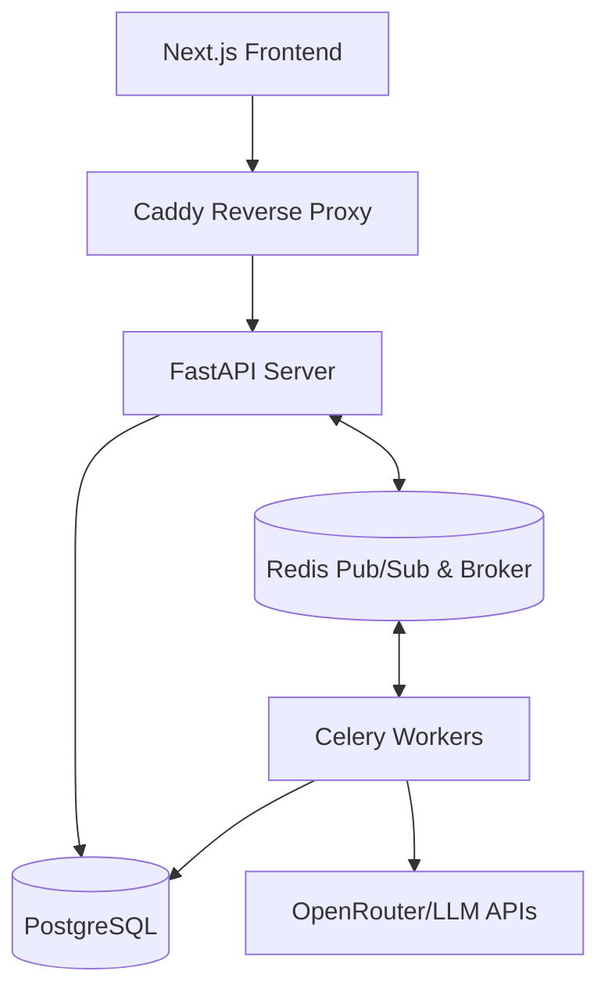

<!-- generated-by: gsd-doc-writer -->
# Architecture

## System Overview
The "Complex" case competition platform is a real-time system where teams solve business cases and trade stocks in each other's companies. The architecture features a Next.js frontend and a fully dockerized FastAPI backend. It leverages asynchronous processing to handle LLM evaluation with human-in-the-loop oversight and real-time market simulation, broadcasting updates to clients via WebSockets.

## Component Diagram



## Data Flow
1. **Request:** Client sends an HTTP request or WebSocket message to the Caddy reverse proxy, which routes it to the FastAPI server.
2. **Synchronous Handling:** FastAPI reads/writes data to PostgreSQL using SQLAlchemy (async mode) for typical REST operations (e.g., authentication).
3. **Background Processing:** For computationally expensive tasks (like stock price simulation ticks or LLM evaluations), FastAPI pushes a job to Redis.
4. **Worker Execution:** Celery workers pick up jobs from Redis, execute them, and store the results back in PostgreSQL.
5. **Real-time Broadcast:** Changes in game state or evaluation outcomes trigger events on Redis pub/sub. The FastAPI WebSocket manager listens to these channels and pushes live updates back to connected Next.js clients.

## Key Abstractions
- `server/app/database.py`: Manages the asynchronous database engine (`create_async_engine`) and session factory.
- `server/app/websocket.py`: Connection manager for WebSocket clients, handling authentication and channel subscriptions.
- `server/app/redis_pubsub.py`: Provides Redis-backed pub/sub for broadcasting events across multiple FastAPI workers.
- `server/app/services/simulation_service.py`: Core logic for managing the case competition rounds, market ticks, and team progression.
- `server/app/services/trading_service.py`: Handles atomic stock transactions, enforcing the 30% cap constraints.
- `server/app/services/llm_service.py`: Interface for calling external LLM APIs (via `httpx`) to evaluate team submissions.
- `server/app/worker/`: Contains Celery task definitions for asynchronous job execution.

## Directory Structure Rationale

```text
.
├── client/           # Next.js frontend code (App Router, Zustand, lightweight-charts)
├── server/
│   ├── app/          # Core FastAPI application
│   │   ├── api/      # HTTP route handlers (REST endpoints)
│   │   ├── schemas/  # Pydantic validation models
│   │   ├── services/ # Business logic (trading, simulation, evaluation)
│   │   └── worker/   # Celery background tasks
│   ├── alembic/      # Database migration scripts
│   └── tests/        # Pytest test suite
├── docker-compose.yml # Orchestration for DB, Redis, API, and Workers
└── Caddyfile         # Reverse proxy configuration
```
- **client/**: Contains the isolated Next.js application, enforcing a strict separation between frontend UI and backend logic.
- **server/app/api/**: Keeps HTTP delivery mechanism separate from business logic.
- **server/app/services/**: Centralizes the complex game mechanics, allowing for easier testing and reuse by both the API and Celery workers.
- **server/app/worker/**: Isolates background processing code to keep the main web server loop fast and responsive.
